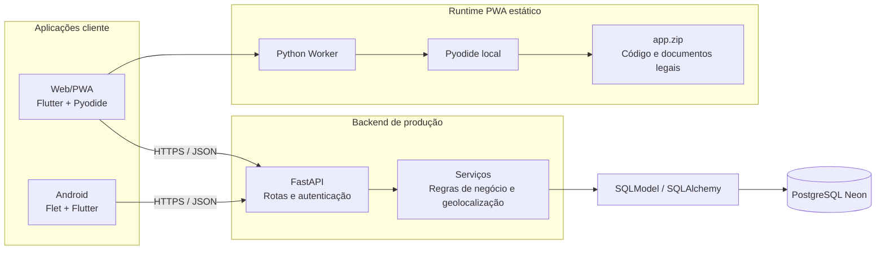

# Conecta Comunidade

Plataforma comunitária para aproximar pessoas que precisam de ajuda, doadores,
voluntários e instituições. A interface é Python/Flet; a API é FastAPI/SQLModel.

## Status da entrega

- Web/PWA: <https://conecta-comunidade-web.vercel.app>
- API: <https://conecta-comunidade-wheat.vercel.app>
- Homologação: `v1.0.0-rc.1`
- Android: o APK de homologação usa certificado **Android Debug** e não é uma
  distribuição oficial nem apta para Play Store.

## Recursos

- Modo visitante, pedidos geolocalizados, ofertas, voluntariado e instituições.
- Emergências priorizadas, chat e agendamento de entregas.
- Cadastro com consentimento explícito, Termos de Uso e Política de Privacidade.
- PWA com ícones oficiais, Python Worker e Pyodide locais, sem CDN para Python.

## Arquitetura

```text
Flet (Android / Flutter Web) → HTTP + JSON → FastAPI + SQLModel → PostgreSQL Neon
                                         └→ SQLite (desenvolvimento e testes)
```



O diagrama separa o runtime local da PWA, a API HTTPS e a persistência. Nem o
APK nem a PWA recebem credenciais do banco ou segredos de autenticação.

| Camada | Tecnologia |
| --- | --- |
| Interface | Flet 0.86.5 / Flutter |
| Web | Flutter Web + Pyodide local |
| API | FastAPI 0.141.1 |
| Persistência | SQLModel / SQLAlchemy |
| Autenticação | JWT HS256 + bcrypt |
| Testes | pytest |

Detalhes: [arquitetura](docs/arquitetura.md) e [API](docs/api.md).

## Desenvolvimento local

Pré-requisitos: Python 3.12–3.14 e ambiente virtual. Para builds Android, use
também JDK 17 e Android SDK.

```powershell
python -m venv .venv
.\.venv\Scripts\Activate.ps1
pip install -r requirements.txt
```

Copie `.env.example` para `.env` somente para desenvolvimento local. Nunca
versione `DATABASE_URL`, `SECRET_KEY`, tokens, keystores ou APKs.

```powershell
# Banco local apenas
alembic upgrade head
python seed.py

# Em terminais separados
uvicorn backend.main:app --reload
flet run mobile/main.py
```

Para usar API local com o app Flet:

```powershell
$env:CONECTA_MOBILE_ENV = "development"
flet run mobile/main.py
```

O padrão do APK/PWA é a API HTTPS de produção. O app não recebe URL de banco,
segredo JWT ou credenciais Neon.

## Validação

```powershell
.\.venv\Scripts\python.exe -m pytest -q
git diff --check
```

As regressões cobrem API, autenticação, CORS, telas Flet, configuração de
produção, ícones e documentos legais em desenvolvimento, staging Android e
`assets/app/app.zip` Web.

## PWA Web

```powershell
.\scripts\build_web_pwa.ps1 -OutputDir build\web
```

`build/web` contém Worker, Pyodide, `app.zip`, ícones, manifesto e configuração
Vercel própria. O pipeline preserva o contrato de splash do Flet e troca sua
identidade visual por carregamento neutro antes da tela oficial do produto.

Publique exclusivamente `build/web` no projeto Vercel
`conecta-comunidade-web`; nunca publique a raiz do repositório nesse projeto.
Veja [publicação Web](docs/web-pwa-publicacao.md).

## Android de homologação

```powershell
.\scripts\build_mobile_homologation.ps1 -OutputDir build\apk-homologacao
```

O script usa staging por allowlist, limites de memória Gradle, workaround JNI e
ícone adaptativo oficial. Para uma assinatura de release, use uma keystore fora
do repositório conforme [assinatura Android](docs/android-release-signing.md).

## Documentos legais

As fontes oficiais ficam em `mobile/assets/legal/`. O staging Android as publica
em `assets/legal/`; o Web as incorpora em `assets/app/app.zip`. Não duplique ou
altere conteúdo jurídico sem revisão. Declarações sobre exclusão, anonimização,
retenção, CPF, compartilhamento ou comunicações devem corresponder à implementação.

## Estrutura

- `backend/`: API FastAPI, modelos, rotas e serviços.
- `mobile/`: aplicativo Flet, componentes, views e documentos legais.
- `scripts/`: pipelines reproduzíveis de staging, Web e Android.
- `deploy/web/`: configuração Vercel do frontend estático.
- `docs/`: arquitetura, API, operação e decisões.
- `tests/`: regressões automatizadas.

## Documentação

| Documento | Conteúdo |
| --- | --- |
| [Arquitetura](docs/arquitetura.md) | Camadas e fluxos |
| [API](docs/api.md) | Endpoints e autenticação |
| [PWA Web](docs/web-pwa-publicacao.md) | Build, validação e deploy isolado |
| [Assinatura Android](docs/android-release-signing.md) | Homologação e release |
| [Homologação RC](docs/homologacao-v1.0.0-rc.1.md) | Evidências da entrega final |
| [Decisões](docs/decisoes.md) | Registro técnico |

Construído pela VyteTech Solutions LTDA.
