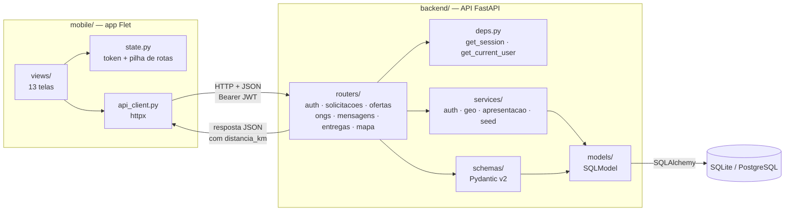
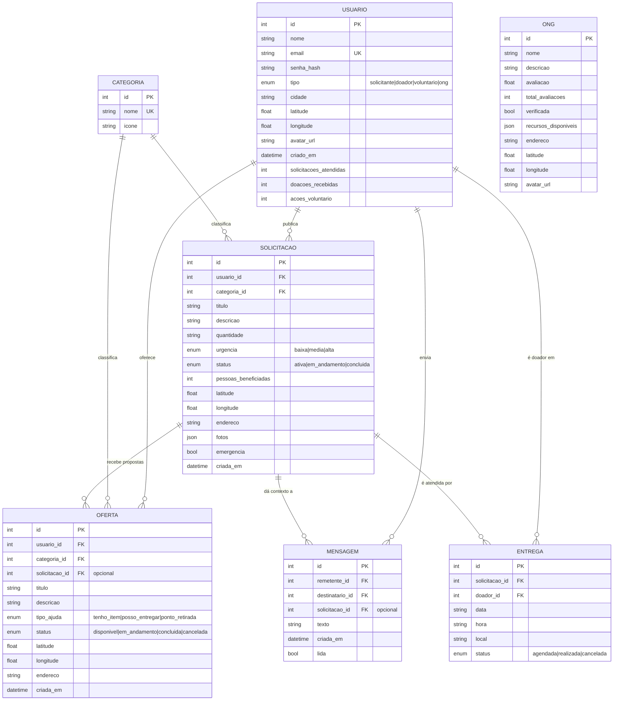
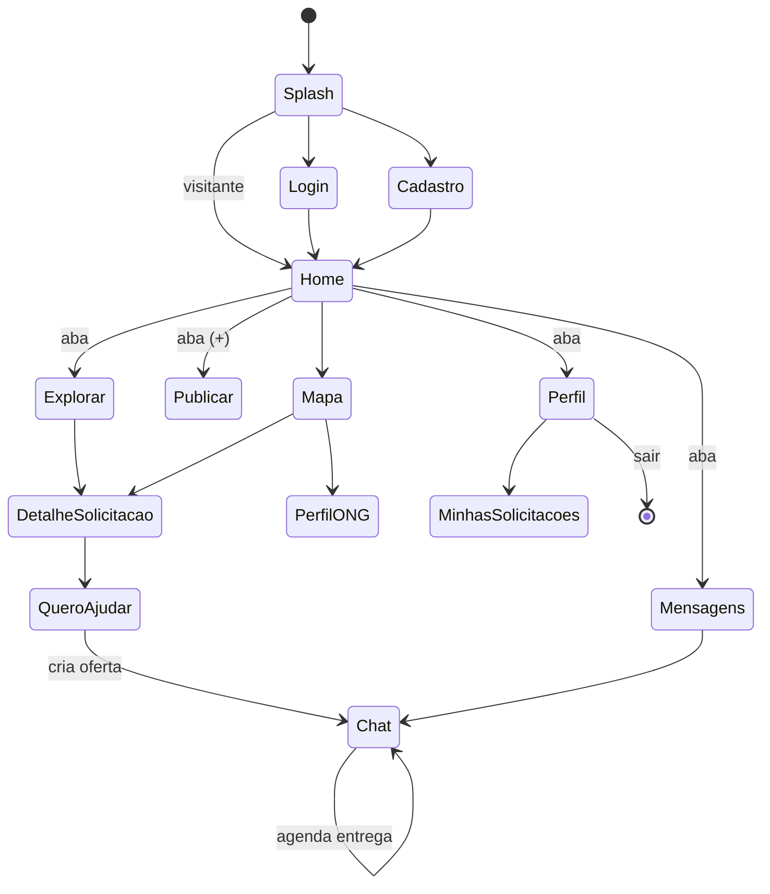

# Arquitetura

`// visão geral do sistema` · Conecta Comunidade · por **VyteTech**

---

## `// resumo`

O projeto é uma aplicação de **duas camadas**, ambas escritas em Python:

| Camada | Papel | Tecnologia |
| --- | --- | --- |
| `mobile/` | Interface, navegação e estado da sessão | `flet` (Flutter renderizado via Python) |
| `backend/` | Regras de negócio, persistência e autenticação | `fastapi` + `sqlmodel` |

Elas se comunicam **apenas por HTTP/JSON**. O app não conhece o banco, e o
backend não conhece a interface — o contrato entre os dois é o OpenAPI gerado
automaticamente pelo FastAPI em `/docs`.

---

## `// fluxo de uma requisição`



### Passo a passo de um "ver pedidos próximos"

1. A view `home.py` chama `app.api.listar_solicitacoes(lat=..., long=...)`.
2. `api_client.py` monta `GET /solicitacoes?...` e injeta `Authorization: Bearer <jwt>`.
3. `deps.get_current_user_optional` resolve o usuário a partir do token (ou devolve `None`, no modo visitante).
4. O router filtra no banco por categoria/urgência/status.
5. `services/apresentacao.py` enriquece cada registro: nome da categoria, autor, `tempo_publicacao`.
6. `services/geo_service.py` calcula a distância haversine e formata em km.
7. A lista é ordenada — **emergências primeiro**, depois por proximidade.
8. O app recebe o JSON pronto e só desenha os cartões.

> A ordenação por distância acontece **em Python, após a consulta**, porque o
> SQLite não tem função haversine nativa. Para volumes maiores, o caminho
> natural é migrar para PostgreSQL + PostGIS e empurrar o cálculo para o SQL.

---

## `// modelo de dados`



**ONG** aparece sem relacionamento no diagrama porque, nesta versão, instituições
são um catálogo público consultado por proximidade — não têm ainda vínculo
transacional com pedidos. Ver `docs/decisoes.md`.

---

## `// camadas do backend`

```
routers/     → HTTP: rotas, query params, códigos de status
  ↓
deps.py      → sessão de banco + usuário autenticado
  ↓
services/    → regra de negócio pura (JWT, haversine, montagem de resposta)
  ↓
models/      → tabelas SQLModel
  ↓
database.py  → engine e sessão
```

Cada camada só conhece a de baixo. `services/geo_service.py`, por exemplo, não
importa nada do FastAPI — é uma função pura, o que o torna trivial de testar
(ver `tests/test_geo_service.py`).

## `// camadas do mobile`

```
views/           → 13 telas, cada uma com construir(app) -> ft.Control
  ↓
components/      → cartões, cabeçalho e navegação inferior reutilizáveis
  ↓
theme.py         → paleta e primitivas visuais
  ↓
state.py         → token, usuário e pilha de rotas
  ↓
api_client.py    → única porta de saída para a rede
```

### Navegação

O app mantém a **própria pilha de rotas** dentro do `AppState`, em vez de usar
o roteamento por URL do Flet:



As cinco abas da navegação inferior **reiniciam** a pilha; qualquer outra tela
**empilha**, e o botão voltar desempilha. Isso mantém o comportamento previsível
em qualquer profundidade.

---

## `// segurança`

- Senhas nunca são gravadas em texto puro: `passlib` + `bcrypt` (salt automático).
- O login devolve um JWT HS256 com o id do usuário no claim `sub` e validade de 7 dias.
- Toda rota de escrita depende de `UsuarioAtual`, que rejeita token ausente, inválido ou expirado com **401**.
- Rotas de leitura usam `UsuarioOpcional`: funcionam para visitantes, mas sem distância personalizada.
- Autorização por dono: só o autor edita a própria solicitação (**403** caso contrário).
- Nenhum segredo versionado — tudo em `.env`, ignorado pelo Git.

---

`Construído por` **VyteTech** — *Tecnologia para negócios.*
